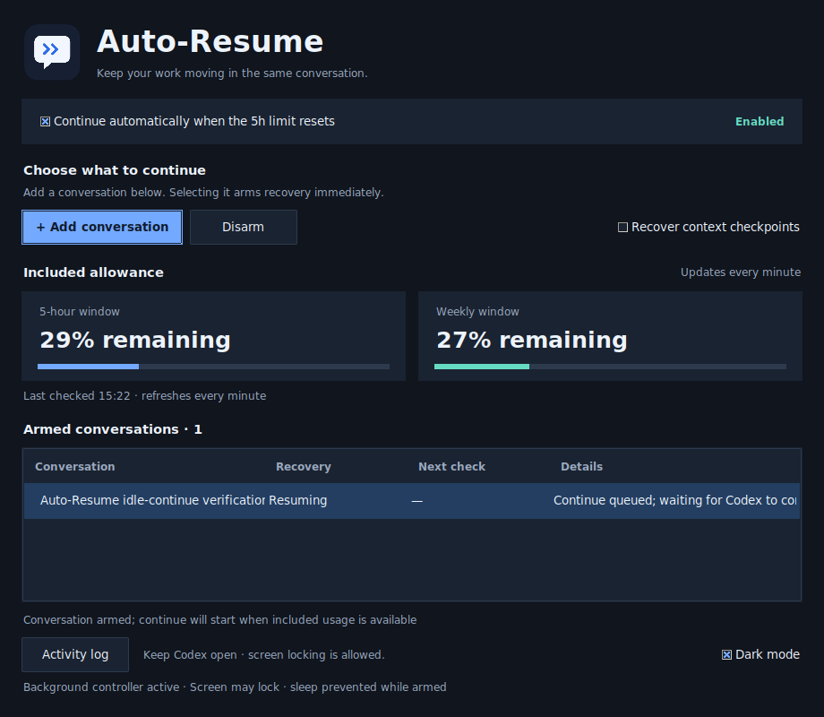
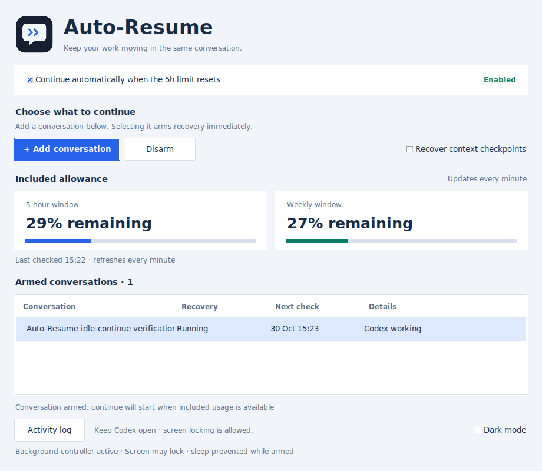

#  Codex Auto-Resume

**Pick up where your Codex conversation stopped.**

Resume explicitly armed chats after included usage resets, with optional recovery from saved context checkpoints. Your conversation, project and model stay together.

[](https://github.com/Manouselis/codex-auto-resume/actions/workflows/ci.yml) · **v0.7.0** · Python 3.10+ · MIT

| Dark mode | Light mode |
| --- | --- |
|  |  |

Screenshots show the live desktop panel; allowance updates automatically every minute.

## Get started

Requires the installed Codex desktop app/runtime (verified with 0.166), signed in to ChatGPT Plus, Python 3.10+, and Tk (`python3-tk` on Ubuntu).

```sh
git clone https://github.com/Manouselis/codex-auto-resume.git
cd codex-auto-resume
python3 scripts/install.py
~/.local/bin/codex-auto-resume ui
```

1. Open the app; the global checkbox starts **ON**.
2. Click **Add conversation**, then select a chat. It is armed and opens in Codex. **Idle chats receive one `continue`; running chats keep working.**
3. Select a queued chat and click **Disarm** to remove it.
4. Enable **Recover context checkpoints** when unfinished work should continue after a context stop.

Selected desktop chats use Codex’s native message queue, verified with runtime 0.166. The real picker-to-`CONTINUED` result is [recorded](docs/evidence/startup-0.7.0.json). Existing [guarded heartbeat bindings](docs/RECOVERY.md#native-desktop-recovery-experimental) are preserved. Unconfirmed sends pause for inspection rather than retrying.

## What to expect

- Fresh included-usage checks before continuing; weekly exhaustion, paid credits and unknown billing routes block work.
- Selecting an idle chat is a fresh user request to continue it once. Normal completion afterward stops recovery.
- Original chat and checkpoint preserved; newer cancellations, approvals and task budgets remain stop conditions.
- Fresh arming is timestamped so the guard can distinguish it from older timer cancellations.
- Lost acknowledgements pause for inspection. Automatic submissions are never blindly retried.
- Multiple armed chats recover independently; duplicate and uncertain submissions are isolated per chat.
- On Ubuntu, the app starts a background controller and prevents sleep while work is armed. **Super+L is supported**; screen locking stays enabled.
- Native wake-ups use normal model turns. Keep Codex open and stay signed in.

The control panel supports dark/light modes, remaining-allowance meters, single-selection arming, an active-only queue and an activity log. The local suite passes **233 tests**, including **19 GUI checks**. A real scheduled restart after a usage-limit interruption is [recorded](docs/evidence/limit-reset-recovery-0.4.0.json); repeated unattended reset cycles remain unverified. See [Testing](docs/TESTING.md).

[Setup](docs/INSTALL.md) · [Recovery](docs/RECOVERY.md) · [Troubleshooting](docs/TROUBLESHOOTING.md) · [Security](SECURITY.md) · [Contributing](CONTRIBUTING.md)
