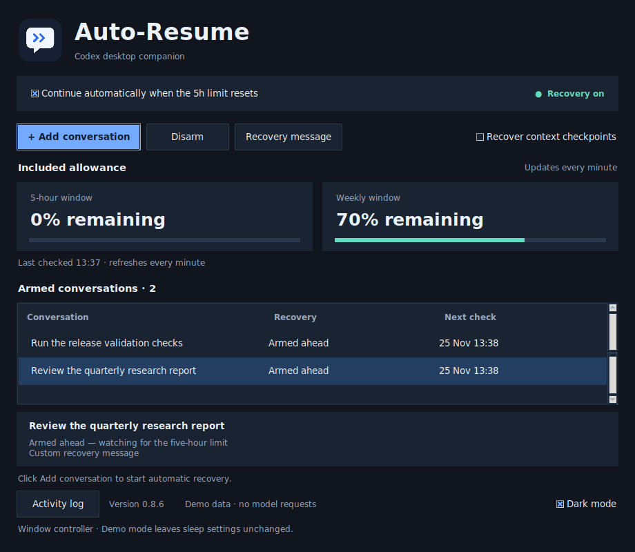

#  Codex Auto-Resume

**Keep your Codex chats moving when included usage resets.**

A desktop companion that resumes explicitly armed Codex conversations in the same chat, with the same project and model. Add multiple conversations to the queue before your five-hour allowance runs out.

[Codex Auto-Resume website](https://manouselis.github.io/codex-auto-resume/)

 · MIT

## Download and open

Python and Tk are bundled. Install the official Codex desktop app and sign in to ChatGPT Plus first.

| Your computer | Download | Install |
| --- | --- | --- |
| Ubuntu 22.04+ · x64 | [Ubuntu installer](https://manouselis.github.io/codex-auto-resume/#download-ubuntu) | Open with Software Install for a fresh install. Use [APT for upgrades](docs/INSTALL.md#upgrade-an-existing-ubuntu-installation). |
| Windows 11 · x64 / ARM with x64 emulation | [Windows installer](https://manouselis.github.io/codex-auto-resume/#download-windows) | Open the installer, then launch from Start. |
| macOS · Apple silicon, 14+ | [Apple silicon app](https://manouselis.github.io/codex-auto-resume/#download-macos-arm64) | Open the disk image and drag the app to Applications. |
| macOS · Intel, 15+ | [Intel app](https://manouselis.github.io/codex-auto-resume/#download-macos-x64) | Open the disk image and drag the app to Applications. |

These community beta installers are unsigned, so Windows and macOS may ask for confirmation. See [installation help](docs/INSTALL.md), [checksums and release files](https://github.com/Manouselis/codex-auto-resume/releases), and the [compatibility test scope](docs/TESTING.md).

Installed copies check GitHub for updates and verify the installer checksum. On Ubuntu, installing or updating the DEB also migrates the standard app-menu shortcut from an older source install. If the update check fails, download the installer for your platform above.

If Auto-Resume closes or shows a startup error, follow the [startup troubleshooting guide](docs/TROUBLESHOOTING.md#auto-resume-cannot-start). Version 0.8.10 adds the app version and a specific message for saved-data failures.

1. Open Auto-Resume. **Continue automatically when the 5h limit resets** starts checked.
2. Click **Add conversation**, search by title or ID, and select an idle or running chat. The chat opens in Codex and shows **Armed ahead** in the queue. Start or keep working in Codex. Repeat to queue more chats.
3. Armed chats stay queued through ordinary manual turns. After a confirmed five-hour interruption, Auto-Resume waits for the reset and verifies fresh included usage before resuming. Click **Disarm** to remove a chat. Normal completion after automatic recovery also removes it.

Select an armed chat to see its recovery status, next check, and message setting. **Open in Codex** takes you to the original chat. **Timeline** shows its recovery history. Use **Recovery message** to choose what Codex receives after a verified reset, or leave it blank to use the built-in prompt.

Allowance refreshes every minute. Optional **Recover context checkpoints** continues unfinished work from saved checkpoints.

The screenshot uses example conversations. [View the light theme](docs/screenshots/light.png).

## Designed for unattended recovery

- Fresh included-usage permission is checked before every continuation. Weekly exhaustion, paid usage, unknown billing routes and approvals block work.
- Lost acknowledgements pause that chat for inspection. Messages are never blindly resent.
- Cancellations, task budgets and account changes remain stop conditions. Once an interruption is pinned, a newer manual turn stops the pending recovery.
- Screen locking is allowed. Armed work requests sleep prevention. Keep Codex open; on Windows/macOS, keep Auto-Resume open or minimized too.
- Ubuntu uses a background controller when a user systemd session is available. Its status is shown in the app.

Live continuation has been verified on Ubuntu with Codex runtime **0.166**. Packaged GUI/install checks use isolated test data; they do **not** establish live Codex integration on every OS or repeated unattended quota-reset cycles. [Evidence and limitations](docs/TESTING.md).

[Installation](docs/INSTALL.md) · [Troubleshooting](docs/TROUBLESHOOTING.md) · [Recovery](docs/RECOVERY.md) · [Building](docs/BUILDING.md) · [Release checklist](docs/RELEASING.md) · [Security](SECURITY.md) · [Contributing](CONTRIBUTING.md)
